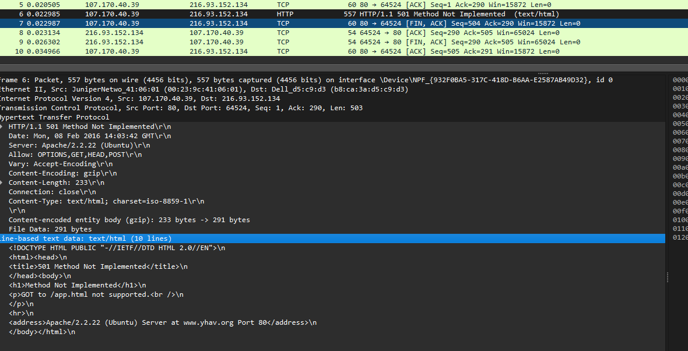

# Lab 14-1: HTTP Response Codes

**Objective**

Analyze HTTP traces for anomalies.

**Applicability to NET215**

Sometimes, a problem between a client and server can only be determined by viewing the data on the wire.  It is necessary to be able to detect anomalies across the wire because the client and the remote server admin aren't always on top of things as you'd expect.

**Assignment**

Find the anomaly in each of the two traces below.

**Submission (Leave each question in place and post your response and screenshots below the question.**

[**Packet Trace File 1**](https://champlain.instructure.com/courses/2682538/files/407188385/download?wrap=1) **&** [**Packet Trace File 2**](https://champlain.instructure.com/courses/2682538/files/407188219/download?wrap=1)

What is the status code returned by the server? **(1 POINT)**

* Packet Trace 1
  * 501
* Packet Trace 2
  * 400

Take a screenshot of the status code and ensure the packet is highlighted that shows the status code. (**1 Point)**

* Packet Trace 1
  *

      <figure><figcaption>
Screenshot of 501 Method Not Implemented Packet
</figcaption></figure>
* Packet Trace 2
  *

      <figure><figcaption>
Screenshot of 400 Bad Request Packet
</figcaption></figure>

What is the general meaning of the respective error code? (**2 Points)**

* Packet Trace 1
  * Method Not Implemented. The server has not created that method yet.
* Packet Trace 2
  * Bad Request. The request was malformed, and the client sent a bad request/bad data.

What caused the respective status code in each packet trace and why? **(2 Points)**

* Packet Trace 1
  * The client tried to send a data continuation, and the server does not support data continuation.
* Packet Trace 2
  * The URI sent by the client does not include a "/", which means that the server does interpret the right path. &#x20;
